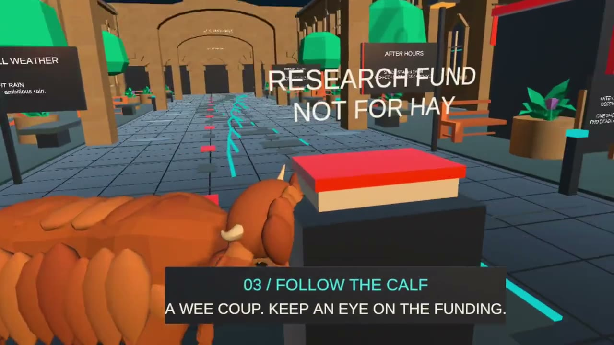

# Cone Courier - Classroom to Canopy

English-only Unity VR game (Unity product name: Binary Lift VR, Android package
`com.binarylift.vr`) set in a University of Glasgow-inspired electronic campus. It teaches
binary lifting: you climb a 35-node tree by hand, collect cones, and remember two- and
four-level connections so later searches need fewer decisions, while every edge is still
climbed physically.

*Demo (about 78 s, 720p): recorded on a Meta Quest 2 with the headset's built-in recorder.
Click the image to play it.*

Current flow: classroom exploration -> exit -> Highland calf theft -> seven connected chase
waypoints -> aerial route reveal -> original generated tree -> manual exploration -> cone collection -> two/four-edge route memory
-> new funding target -> manual reuse -> results -> replay from the classroom. There is no second-game handoff.

## Status
- Runs on Meta Quest 2 (standalone Android, OpenXR). A build was sideloaded and played
  on a headset on 2026-10-20; the demo above is that session.
- The approved animated Highland calf is the thief and carries the funding. It replaced the
  earlier monkey placeholder.
- Quest-specific fixes on the `quest-fixes` branch: the OpenXR loader is declared in the
  manifest at build time (Android 12+ otherwise hung the app on the loading dots), engine
  code stripping is off so primitive colliders survive, and controller pointers have a
  saved recalibration (see VR controls).
- Recent gameplay tweaks: the branch workbench labels FROM / VIA / TO nodes with START and
  YOU ARE HERE, and the opening walk is about 30 percent faster (2.2 m/s).
- Not done: the full Docs/VRValidation.md checklist, on-device profiling (frame time,
  thermals) and any audio. Treat comfort and performance as unverified.

The campus detail pass adds stone window frames, a moving clock, kiosk/entrance
dressing, gentle banners, rain puddles and a more detailed coffee machine. Cones
have continuous tapered surfaces. All existing physical tasks and climbing remain.
The approved warm Highland calf now carries the funding throughout the chase and
later searches. Its native rig plays idle, walk, gallop and head-lowered animations;
recovery removes the carried envelope and replay resets both character and funding.
Classroom posters and audit copy use the same calf/hay theme. The shared approved
adaptation is in Tools/CalfPreview, with the original CC0 source in SourceArt/HighlandCalf.

## Run
Open Assets/Scenes/Main.unity in Unity 6000.0.85f1 and press Play. Scenery is generated
at runtime; Edit Mode intentionally has no game camera. Stop Play before editing C#.
Use Assets > Refresh after editing. Double-click the Game tab for a larger view.

## Run on Quest
Run BinaryLift > Configure Project once (OpenXR plus Meta Quest Support for Android), or
build in batch mode with BinaryLiftSetup.BuildAndroid; the APK goes to Builds/ and is not
committed. Enable developer mode on the headset, connect it with USB and sideload:

    adb install -r Builds/BinaryLift.apk

Sideloaded apps appear under Unknown Sources in the Quest library. To launch from the
computer: `adb shell monkey -p com.binarylift.vr -c android.intent.category.LAUNCHER 1`.
For demo footage use the headset's built-in recorder (Sharing > Record) and pull the file
from /sdcard/Oculus/VideoShots with adb. scrcpy shows the lens-warped per-eye image
(use `--no-audio`, as the Quest blocks audio capture), so it suits monitoring, not demos.

## Desktop controls
- WASD: explore the classroom/courtyard. Hold right mouse to look; Q/E: snap turn.
- Optional EXIT TO COURTYARD button walks through the door. Walking near the funding envelope
  outside triggers the theft once; starting the game does not trigger it automatically.
- Follow each orange waypoint by walking or clicking its beacon. WASD cancels auto-walk.
- Start with 1 LEVEL. Explore two edges, collect a cone, then drag the orange memory
  plug to the cyan socket (or click each). Explore two more edges and repeat; join
  the two remembered routes into a four-edge connection. Climbing has no quiz gate.
- FOLLOW THE FUNDING returns to the same tree start with memory intact and a new goal.
  Hover available 1/2/4 LEVELS to preview; click to select. Memory is specific to nodes.
- Click and drag an orange branch hold downward. Release to rest, then regrip.
  Selecting a route or holding still never moves the player. Each actual node crossing
  increments CLIMBED; THIS ROUTE shows completed levels within the current selection.
- Grey connections are undiscovered at this node or pass the goal. This slice stops
  at four-level memory. Seed 13 explores four levels, then revisits the start for the
  original six-level goal: four remembered levels plus two individual edges.
- Recover the final cone. NEW TARGET keeps memory and cycles 3/5/7/4/6-level goals;
  REPLAY FROM CLASSROOM clears progress. Neither launches the legacy game.
- R restarts with a fade. There is no chase timer or falling penalty.
- OPTIONAL QUIZ at results opens a short calf-auditing challenge. Wrong answers
  explain the concept and permit retry; BACK / SKIP always returns to results. One
  audit stamp can be earned per search. Stamps never substitute for physical climbing.
- In the classroom, drag the cup below the spout, click BREW, wait for the visible
  fill, then drag it to the saucer. Drag the stamp onto the form, then the stamped
  form into the in tray. Pull the drawer downward on screen and click the route card.
  Invalid drops return props safely. These activities are optional; exit at any time.
  Point at the horse's head to greet the companion.
- RECORD NEW ROUTES at results builds further twos/fours from the edges you explored.
  BACK cancels safely. Research keeps existing memory and returns to the same results.
  MEMORY BEST compares decisions with the connections available at mission start.
  A six-level route can improve from 4+1+1 to 4+2 after recording the final pair;
  all six levels still require manual climbing.

## VR controls and presentation
Left stick moves; either controller trigger selects. Grip near an orange hold and pull
down to climb; alternate hands, release to rest. Two-hand input is averaged. Right stick
snaps when no hold is held; B/Y restarts. Grip near the cone or select it with a ray.
If a pointer ray aims off, press that thumbstick while pointing straight ahead to
recalibrate it; the offset is saved per hand (default pitch 70 degrees).
Select the orange plug and then the cyan socket to compose a memory connection.
The branch workbench shows FROM / VIA / TO anchors and animates the shared middle node.
Desktop reveal raises and tilts the camera. VR fades to a stationary overlook, preserving
tracked head rotation; look down at the campus. Map/tree changes use a fade.
No forced head bob, camera roll or falling. Device comfort and reach still need testing.
At campus worktops, grip within 12 cm of a prop to pick it up, move your hand and
release at the destination. Pull the drawer toward you. Trigger rays operate BREW
and collect the card; physical props use near grip. Movement and snap turn pause
while holding a prop. Tracking loss, focus loss and restart safely release it.

## Original tree contract
TreeGenerator.Generate(13,16,18), RaceState.Create and TreeLayout.ComputeX(tree,1.3)
provide the original 35-node topology, final target and layout. Vertical spacing is one metre.
Selection schedules a real ancestor chain; manual motion follows every edge, including
its horizontal displacement. Each edge requires 0.65 m of accumulated downward input.
Larger selections reduce decisions and stopping points, not physical distance or effort.
RaceController and rejected prototypes remain as historical source, with no adventure
button or completion path that launches them.

## Validation and collaboration
Run Scripts/Test-Logic.ps1 (Unity Mono; optional -UnityEditorRoot for another installation).
BinaryLift > Validate Adventure (Ctrl+Shift+J) runs method-driven integration.
BinaryLift > Capture Adventure Screenshot (Ctrl+Shift+K) records the current view.
Read Docs/AdventureValidation.md and Docs/CampusLifeValidation-2026-10-18.md for
actual input evidence and hardware limitations.
Desktop Play Mode is not a headset test. The game has been played on a Quest 2 (see Status),
but the structured headset checklist in Docs/VRValidation.md has not been completed.

Approved Poly Haven sandstone, bark and wood maps, Kenney food, planting and furniture,
and a separately preview-approved
AI funding poster are now used, plus the approved calf. The horse and architecture remain project-built.
Read Docs/AssetRegister.md for provenance, licences and pending character reviews.
The calf is the Quaternius-based adaptation approved on 2026-10-18; it replaced the monkey
as the funding thief. The companion horse and project-built architecture remain.
The learning loop is specified in Docs/Design.md. No audio or university-photo pixels
are imported. This remains a stylized campus prototype, not a surveyed reconstruction.

Read AGENTS.md, Docs/Handoff.md, Docs/Design.md and Docs/TeamWorkflow.md before changes.
Keep English development logs and handoffs current. Runtime milestone logs remain local
under Application.persistentDataPath/QuestLogs; no account data or pose streams are logged.
The user authorized GitHub uploads to https://github.com/isym444/BinaryLiftVR.git on
Fexas only. Verify branch and remote before each push; do not push main or force-push.
